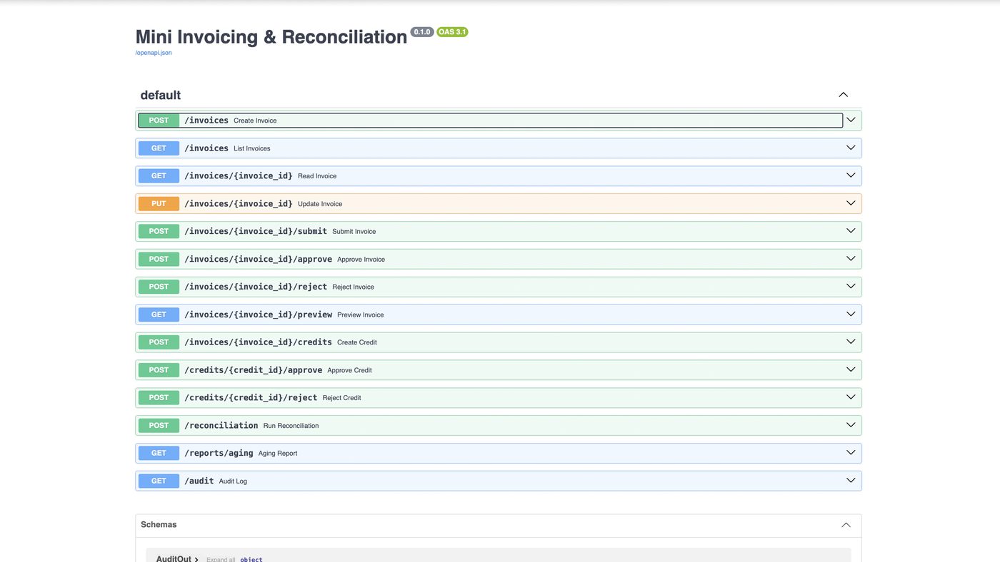
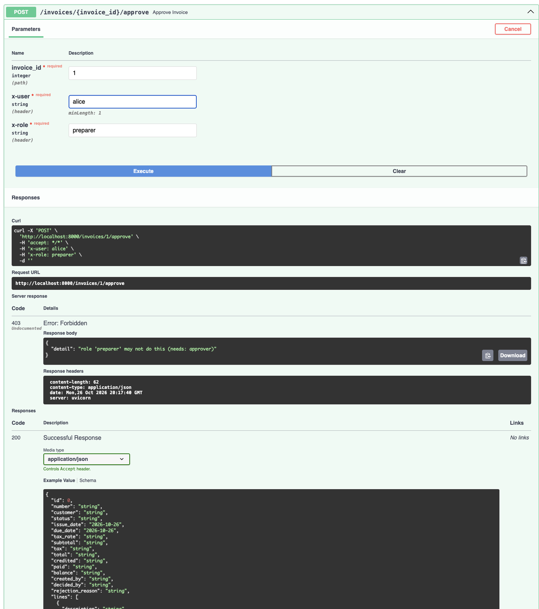
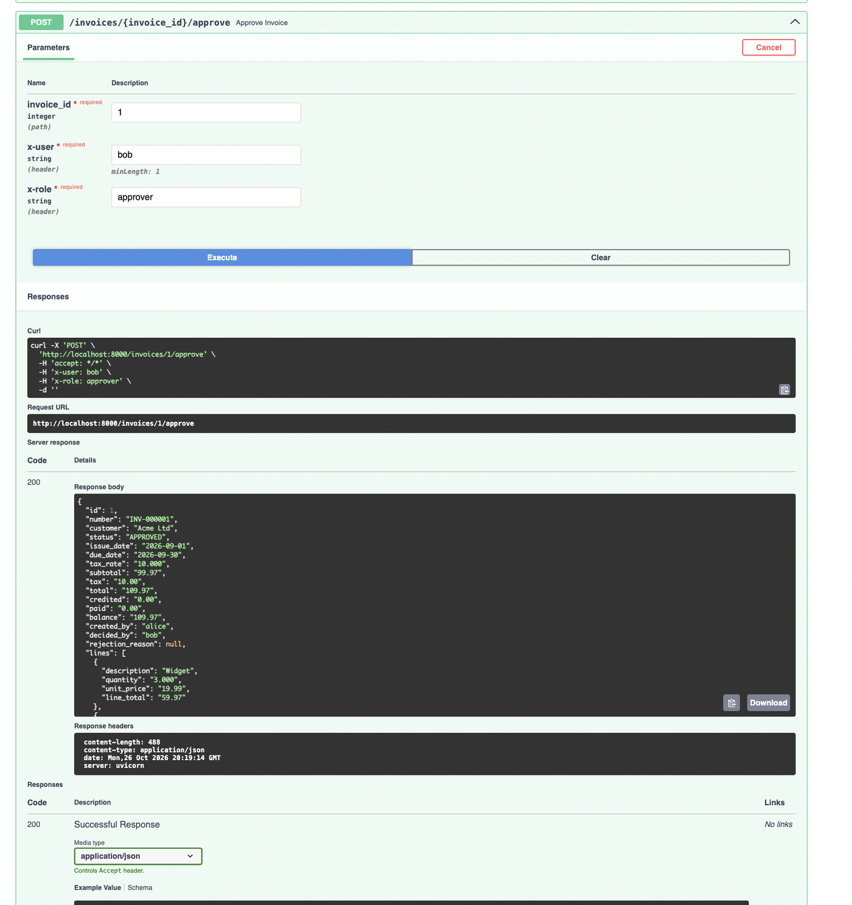
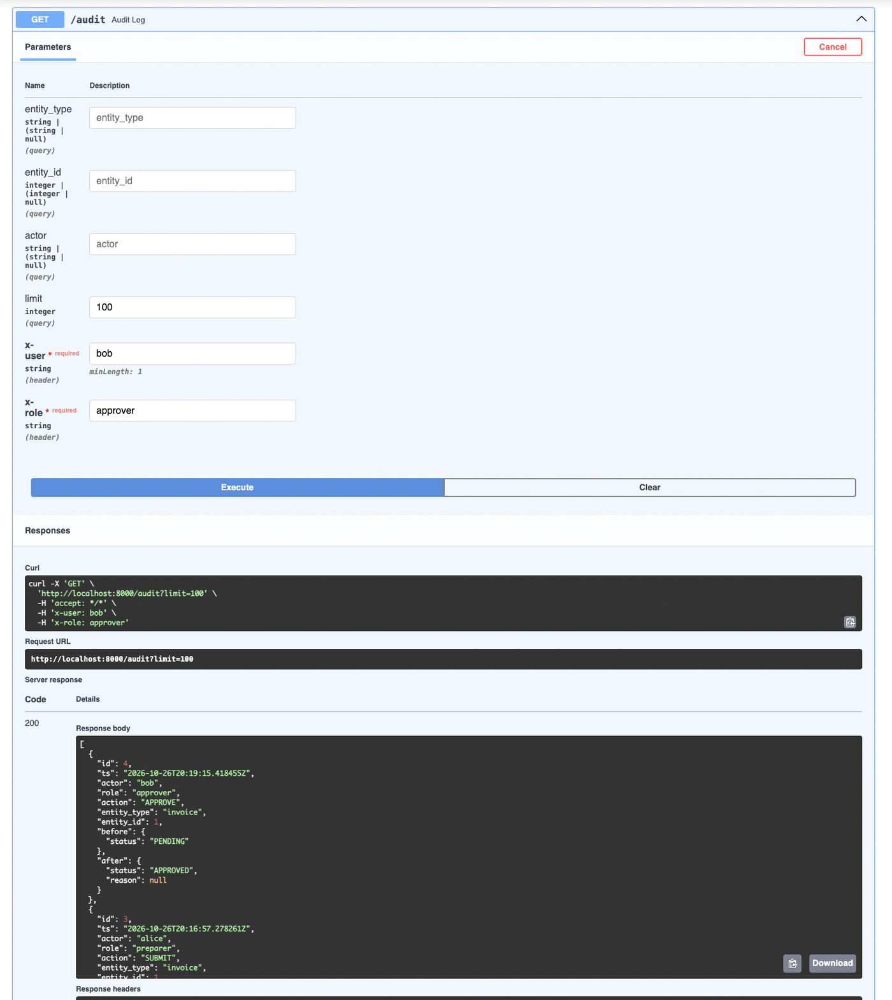
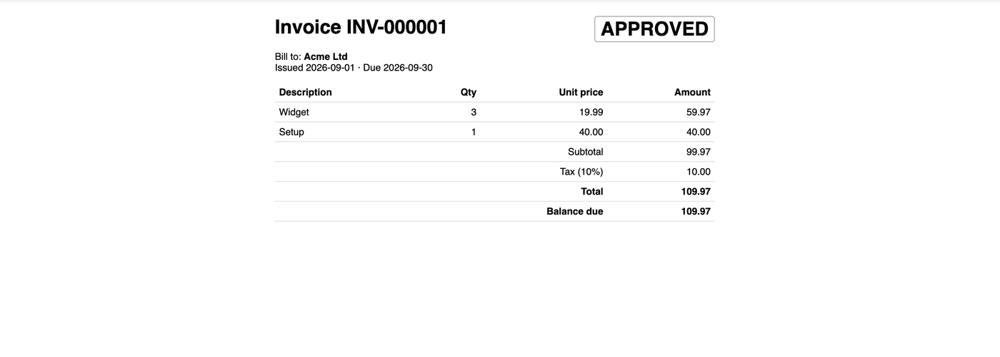

# Ad Billing & Reconciliation

A backend service for billing ad campaigns and reconciling payments, built with **FastAPI, PostgreSQL and SQLAlchemy**.
It covers the full accounts-receivable loop: CPM-based invoicing from campaign bookings, credit memos, a maker-checker
approval workflow, payment reconciliation from CSV, delivery anomaly flags, and an append-only audit trail.

All money is Python `Decimal` (never floats). **82 automated tests.**

## Screenshots

**Interactive API docs (Swagger)**



**Permissions: a preparer cannot approve (403 with a clear message)**



**Approval workflow: an approver approves; totals are exact (`99.97 + 10.00 = 109.97`)**



**Audit log: who did what, when, with before and after state**



**Invoice preview**



**Tests and concurrency check (real PostgreSQL)**

```
$ python -m pytest -q
82 passed

$ python scripts/concurrency_check.py
HTTP codes: [200, 200, 200, 200, 200, 200, 200, 200, 200, 200]
paid=40.00  balance=60.00
OK: 10 simultaneous uploads, payment applied exactly once
```

## Features

| Feature | Where |
|---|---|
| Invoices with line items, totals and HTML preview | `POST /invoices`, `GET /invoices/{id}/preview` |
| Approval workflow (draft, submit, approve or reject) with maker-checker | `/invoices/{id}/submit`, `/approve`, `/reject` |
| Credit memos with approval | `POST /invoices/{id}/credits`, `/credits/{id}/approve` |
| Payment reconciliation from CSV: matched, partial, overpaid, unmatched, duplicate, invalid | `POST /reconciliation` |
| CPM billing from campaign bookings | `POST /campaigns` |
| Daily delivery uploads with anomaly rules | `POST /delivery` |
| Under-delivery settlement: auto-drafted makegood credit | `POST /campaigns/{id}/settle` |
| Aging report | `GET /reports/aging` |
| Append-only audit log | `GET /audit` |
| Two roles: `preparer` and `approver` | `X-User` and `X-Role` headers |

## Run it

```bash
docker compose up -d                        # PostgreSQL
python3 -m venv .venv && source .venv/bin/activate
pip install -r requirements.txt
python -m uvicorn app.main:app --reload     # docs at http://localhost:8000/docs
python -m pytest -q                         # tests use in-memory SQLite, no DB needed
python scripts/concurrency_check.py         # needs the server running against PostgreSQL
```

Auth is two headers: `X-User: alice`, `X-Role: preparer|approver` (a stand-in for JWT).

## Quick demo

```bash
P='-H X-User:alice -H X-Role:preparer'; A='-H X-User:bob -H X-Role:approver'
curl -X POST localhost:8000/invoices $P -H 'content-type: application/json' -d '{"customer":"Acme","issue_date":"2026-09-01","due_date":"2026-09-30","tax_rate":"10","lines":[{"description":"Widget","quantity":"3","unit_price":"19.99"}]}'
curl -X POST localhost:8000/invoices/1/submit $P
curl -X POST localhost:8000/invoices/1/approve $A
printf 'payment_id,reference,amount,date\np1,INV-000001,50.00,2026-10-01\n' > pay.csv
curl -F file=@pay.csv 'localhost:8000/reconciliation?apply=true' $A
curl localhost:8000/audit $A
```

## Ad-delivery billing (CTV-style)

A **campaign** is an insertion order: N booked impressions at a CPM (price per 1,000) over a flight window.

1. `POST /campaigns` drafts its invoice: quantity = impressions / 1000, unit price = CPM.
2. `POST /delivery` takes a daily CSV `campaign,date,impressions` (dry run by default; approvers apply). Stored days are never overwritten: the same number is a `DUPLICATE`, a different number is a `CONFLICT`.
3. Anomaly rules run on every upload: `MISSING_DAY`, `ZERO_DELIVERY`, `SPIKE` (more than 3x the median of the other days).
4. `POST /campaigns/{id}/settle` (approver, after the flight ends): under-delivery auto-drafts a PENDING makegood credit (including tax) from `delivery-bot`, which a human approver must still approve. Over-delivery is flagged, never billed.

## Design decisions

- **Decimal everywhere**, half-up rounding per line, `NUMERIC` in the database, money serialized as strings. Sub-cent input is rejected, not silently rounded.
- **Balance is derived** (`total - approved credits - payments`), never stored, so it cannot drift.
- **Maker-checker:** the creator of an invoice or credit cannot approve it. Approvers alone apply payments and read the audit log.
- **Audit log** is written in the same transaction as each change and has no update or delete path.
- **Reconciliation logic is pure** (`app/reconcile.py`, `app/delivery.py`: no DB, no web), so every rule is unit-tested directly.
- **Duplicates** are caught by payment ID and by same invoice, amount and date, with a UNIQUE constraint as the final backstop.
- **Concurrency:** `SELECT ... FOR UPDATE` row locks serialize competing uploads; a race that slips through returns a clean 409.
- **Strict CSV parsing:** `Decimal("NaN")` and `Decimal("1e5")` are valid Decimals, so amounts are matched with a regex; rows with extra columns are reported, not crashed on.

## Known limits and next steps

Single currency, no refunds or negative payments, header-based auth instead of JWT, no migrations (Alembic), no pagination, the row lock is coarse (all invoices, not only those in the file), and no front end.
